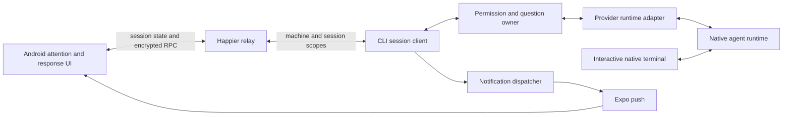

# Pinned repository audit

Terminal Companion bootstrap audit, 2026-10-16. Beads: **tc-ach.1**. This is an architecture assessment for review, not an implementation or a release certification. [SPEC.md](SPEC.md) remains the product contract; [PLAN.md](PLAN.md) remains the phase document. Beads owns execution status.

**Recommendation:** extend Happier's existing native-provider, session, encrypted RPC, attention, and notification owners. The source already contains shared Codex/OpenCode terminal control and a Claude unified-terminal implementation. It does **not** establish the requested three-provider Windows/Android experience. Codex explicitly disables its shared path on Windows; Claude's local/remote permission race needs native evidence; the existing permission wire and notification defaults do not meet the complete fork contract.

**Validation limits:** a native-Windows dependency-free baseline returned **15 passed, 2 failed**. Both failures are Unix-path expectations in compiler-tooling tests. The current service-wrapper renderer passed a separate native PowerShell warning/continuation/exit-code experiment. Package tests, typechecks, provider sessions, two-computer interaction, and physical Android were not run. No dependencies, providers, credentials, services, workflows, or global installations were changed.

## Evidence basis

Labels used here:

- **Observed—source:** reachable code or declarations inspected at the revision below. This proves implementation shape, not a working live workflow.
- **Observed—execution:** an actual command and terminal result from this audit.
- **Derived:** a conclusion from the named source/runtime evidence.
- **Unverified:** an empirical or authorization prerequisite remains. Proposed work is explicitly a recommendation.

| Item | Observed basis |
|---|---|
| Fork HEAD | `eb943730622b4974eeb78d717290b7b4b914160e` |
| Upstream source pin | `cb5f427183391e8f65b8ffa7f1682e10d3a045f7`, from [UPSTREAM_BASELINE.json](UPSTREAM_BASELINE.json), corroborated by local Git history |
| Branch / worktree | `companion/main`; `C:\Users\Raziel\projects\terminal-companion`; one listed worktree; initially clean |
| Origin | `https://github.com/razor389/terminal-companion.git`, fetch and push |
| Upstream | `https://github.com/happier-dev/happier.git`, fetch; push URL `DISABLED` |
| Source delta | The three fork commits add bootstrap/instruction/Beads files. `git diff --stat <source-pin> HEAD` showed no application/package implementation changes |
| Package versions | CLI/server `0.2.16`, UI `0.2.17`; manifest versions are **not** proof of corresponding installed or released artifacts |
| Audit actor | `raziel-desktop1-codex-bootstrap`, inherited from `BEADS_ACTOR`; successful atomic claim and heartbeats |

This is the pinned 0.2 source line. There is no sibling `../0.3/apps/stack/bin/hstack-exec` here. No production change was made, so this audit has no implementation batch to port. No upstream release/deployment provenance was established; compatibility claims are limited accordingly.

Root instructions were read, together with the bootstrap prompt, companion contract/security/acceptance/workflow documents and seed. Package instructions discovered are `apps/{cli,ui,server,stack,docs}/AGENTS.md`; CLI and stack guidance informs the commands and future ownership below. Internal audit documents have no nearer `AGENTS.md`. Workers must read their applicable package instructions before edits.

## Tooling and baseline readiness

| Tool or prerequisite | Actual observation |
|---|---|
| Host | Native Windows `10.0.26200.0`; Windows PowerShell `5.1.26100.9711` |
| Node / npm | `v22.14.0` / `10.9.2`; inherited CI uses Node 22.x in inspected jobs |
| Yarn | Repository pin `yarn@1.22.22`; no Yarn command on PATH; Corepack `0.31.0` is installed, but an offline version probe could not find a cached Yarn and wanted the npm registry |
| Dependencies | Root `node_modules` absent. No dependency installation attempted |
| Codex | `codex-cli 0.160.0`, version/help only |
| Claude Code | `2.1.299`, version only |
| OpenCode | Not found on PATH; version unknown, not proof of absence elsewhere |
| Beads | `1.3.1 (c1c4b642a)`; seed IDs already exist, so no init or reseed |
| Dolt | PATH executable reports **1.86.1**. Integration review confirmed the actual loopback server on port 3308 runs **2.2.0**, matching the companion pin; its executable is under the dedicated `tools/dolt-2.2.0/` installation |
| Android/native tools | `adb`, `java`, and Bun not found on PATH. Android SDK/device/build identity and terminal host remain unattested |
| Search/test routing | Git for Windows Bash successfully ran `./apps/stack/bin/hstack-exec -- ...`; its standalone fallback executed native Windows Node and `rg`, not WSL |

`bd` initially selected an npm PowerShell shim blocked by execution policy. `bd.cmd` worked; execution policy was unchanged. Sandboxed Beads commands sometimes warned that their workspace gate could not access the parent directory while still returning successful DB results. A narrowly approved unsandboxed heartbeat acquired the gate without that warning. This is not evidence that every later sandboxed call had a functioning gate.

Beads metadata names server mode, loopback `127.0.0.1:3308`, database `terminal_companion`, prefix `tc`. `bd where` reports this checkout's `.beads` path; that does not prove the actual Dolt data directory is outside the checkout. `bd doctor` reported **81 passed, 6 warnings, 0 errors**: missing recommended Git hooks, missing ignore patterns, a Dolt remote matching Git origin, missing Cursor hooks, AGENTS/CLAUDE divergence, and federation server unavailable. Do not apply its generic init/fix suggestions automatically. `bd config list` reports `sync.remote=upstream`, while local YAML names the fork and an additional personal planning workspace. Integration review identified the running server as 2.2.0 and confirmed its loopback listener; the SQL data-directory result was empty and `bd backup status --json` reported no configured Dolt backup. Effective routing/sync provenance, data location, common-worktree resolution, and backup recovery remain in **tc-ach.25** before multiple writers. No Dolt remote sync was run.

Dependencies belong to existing packages:

- CLI: `@agentclientprotocol/sdk`, Claude Agent SDK, `ws-node`, Socket.IO client, `tweetnacl`, `node-pty`, and `@homebridge/node-pty-prebuilt-multiarch`. Manifest ranges are not installed versions. Native PTY availability and Windows command-shim behavior need real checks; an SDK dependency does not prove the native terminal contract.
- UI: Expo `^54.0.0`, React Native `0.81.5`, `expo-notifications ~0.32.11`, and Socket.IO client. An Android build needs its native toolchain and isolated application/push identity.
- Server: Fastify/Socket.IO, Prisma, and configured storage. No development relay or database for the product was started.
- First-party compilation is selected by `scripts/workspaces/typescriptCommand.mjs` through `runTypeScriptCli.mjs`; manifests pin `@typescript/native` to `npm:typescript@7.0.2` and retain TypeScript 5.9.3 for API consumers. Do not use an arbitrary global `tsc`.
- Installation has lifecycle work: root `scripts/pipeline/expo/eas-postinstall.mjs`, CLI tool unpacking, UI native patches, server schema generation, and workspace builds. A future install must review these and preserve `yarn.lock`; this audit did not execute them.

## Existing architecture and reusable owners

The Android app is a client of authenticated relay/session state. Provider execution remains on a machine. Session RPC reaches the registered local runtime, which translates it to native provider APIs or the Claude hook/terminal boundary. The provider remains the authority for whether a request can still be answered.



The graph is a responsibility map. It does not assert that sync is already an independently restartable process. Native terminal/API topology differs by provider.

| Responsibility | Existing owner and important dependency |
|---|---|
| CLI dispatch / provider composition | `apps/cli/src/index.ts`, `apps/cli/src/backends/catalog.ts`, `apps/cli/src/backends/types.ts`, provider `index.ts` leaves. Reuse this registry instead of a second adapter registry |
| Shared provider facts / UI composition | `packages/agents/src/manifest.ts`, `packages/agents/src/runtime/terminal/control.ts`; `apps/ui/sources/agents/registry/` and provider leaves. Runtime availability must remain distinct from declared capability |
| Native session execution | `apps/cli/src/backends/{codex,claude,opencode}/run*.ts`; generic `apps/cli/src/agent/runtime/runStandardAcpProvider.ts`; `apps/cli/src/agent/core/AgentBackend.ts` |
| Shared terminal presentation | `apps/cli/src/agent/localControl/createSharedProviderLocalControl.ts`, `createAttachedTerminalSupervisor.ts`; `apps/cli/src/terminal/runtime/terminalLaunchSpec.ts`; concrete `apps/cli/src/integrations/terminalHost/` adapters |
| Machine/process lifecycle | `apps/cli/src/daemon/startDaemon.ts`, daemon session tracking, `apps/cli/src/daemon/sessionRunnerLock.ts`; machine inventory already exists. Reuse it rather than introducing a machine scheduler |
| Pending permissions | `apps/cli/src/agent/permissions/permissionRequestCoordinator.ts`, `agentStateRequestStore.ts`, `BasePermissionHandler.ts`, `ProviderEnforcedPermissionHandler.ts`, `sessionPermissionRpc.ts` |
| Questions | `packages/protocol/src/tools/structuredQuestionAnswersV1.ts`; `apps/cli/src/agent/questions/`; UI `AskUserQuestionView.tsx` and `buildAskUserQuestionAnswerPayload.ts` under `apps/ui/sources/components/tools/renderers/workflow/` |
| Transport / synchronization | `apps/cli/src/api/session/sessionClient.ts`, `apps/cli/src/api/rpc/RpcHandlerManager.ts`, `apps/cli/src/api/offline/`; UI `apps/ui/sources/sync/engine/socket/socket.ts`; shared `packages/connection-supervisor/src/` |
| Relay authorization / routing | `apps/server/sources/app/api/socket.ts`, `socket/rpcHandler.ts`, `socket/resolveRpcCallTarget.ts`, `socket/machineSocketOwnershipRegistry.ts`; `packages/protocol/src/socketRpc.ts` and `rpc.ts` |
| Encryption / pairing | `apps/cli/src/api/encryption.ts`, `packages/protocol/src/crypto/terminalProvisioningV2.ts`, UI `apps/ui/sources/auth/terminal/terminalProvisioning.ts` and `sync/encryption/`; server `api/routes/auth/registerPairingAuthRoutes.ts`. Reuse these; no new crypto |
| Mobile attention / actions | `apps/ui/sources/activity/attention/activityAttentionSessions.ts`, `sync/domains/session/pending/listPendingSessionRequests.ts`, `sync/domains/session/attention/deriveSessionRuntimePresentationState.ts`, `components/inbox/`, `sync/ops/sessions.ts`, and `components/tools/shell/permissions/PermissionFooter.tsx` |
| Push | `apps/cli/src/settings/notifications/permissionRequestPushNotifier.ts`, `apps/cli/src/activity/notifications/`, `apps/cli/src/api/pushNotifications.ts`; UI `activity/notifications/` and `sync/engine/account/syncAccount.ts`; server `api/routes/push/pushRoutes.ts` |

**Derived architecture recommendation:** keep one protocol/lifecycle authority under coordinator task **tc-ach.2**. Shared versioned wire contracts belong in `packages/protocol/src/`, with existing `rpc.ts`, `socketRpc.ts`, and structured-question exports as entry points. Extend the existing CLI request coordinator and migrate its UI callers together. Do not create a relay-owned permission database, a parallel mobile pending-request store, or a second parser that treats terminal output as approval authority.

## Provider feasibility

### Codex: substantial reuse, explicit Windows blocker

**Observed—source:** `runCodex.ts` selects an App Server path and, when supported, constructs `appServer/createCodexSharedAppServer.ts` and `localControl/createCodexSharedLocalControl.ts`. The shared server uses a private Unix endpoint. `localControl/createCodexSharedAttachArgs.ts` builds `--remote <endpoint> --cd <directory> resume <sessionId>` for the native TUI. Here `resume` names a thread on the same server; the word alone does not establish a second executing process. Live PID/endpoint/thread evidence is still required.

`createSharedProviderLocalControl.ts` publishes `topology: 'shared'` and `remoteWritable: true`. The Codex runtime listens for `serverRequest/resolved`, checks client generation and thread identity, and cancels the matching local pending request when another Codex client resolves it (`appServer/runtime.ts`, around line 4294). These are useful existing arbitration hooks.

**Observed—source blocker:** `localControl/resolveCodexSharedControlSupport.ts` unconditionally returns unsupported on `win32`. The shared client uses `client/createCodexUnixWebSocket.ts`, whose connection is `node:net.createConnection(socketPath)`. The source explains the Windows AF_UNIX versus Node named-pipe mismatch. The alternative `daemonProxy` transport exists, but `runCodex.ts` also excludes it from this shared-control selection. The exclusive local/remote path is not acceptable Terminal Companion parity.

**Observed—tool / unverified feasibility:** installed Codex 0.160.0 help lists `--remote` WebSocket/Unix endpoints, a daemon proxy command, and App Server WebSocket authentication flags. Evaluate existing native proxy capability and an authenticated loopback WebSocket against an AF_UNIX bridge before adding native machinery. No option was enabled and no daemon was contacted. The [official App Server reference](https://learn.chatgpt.com/docs/app-server) documents request IDs, thread/turn IDs, and resolution notifications, but describes WebSocket transport as experimental and unsupported for production. A transport connection alone cannot close **tc-ach.5** or provider parity **tc-ach.11**.

### Claude Code: opt-in unified terminal, unresolved local race

**Observed—source:** `runClaude.ts`, `unifiedTerminal/claudeUnifiedTerminalLauncher.ts`, and `unifiedTerminal/runClaudeUnifiedTerminalSession.ts` own the native-terminal route. `remote/claudeRemoteMetaState.ts` defaults unified terminal to **false**. Existing local and SDK remote modes remain separate alternatives, not evidence that the fork requirement already holds by default.

`localPermissions/localPermissionBridge.ts` publishes requests through the shared store/coordinator; `utils/startHookServer.ts` binds loopback and validates a configured hook secret. It handles permission and question hooks with expiry and cancellation. Missing provider tool-use IDs can be recovered from the transcript or replaced with generated IDs; **tc-ach.6** must prove those identities remain bound to the exact live waiter. Hook callbacks and HTTP receipts do not prove that the native terminal can answer concurrently or that the provider applied a response.

Ordinary input already has `createClaudeUnifiedInputArbiter.ts`, `createClaudeUnifiedPromptInjector.ts`, and `ownComposerDraftGuard.ts`. These distinguish foreign drafts, ambiguous capture, owned leftover input, and provider acceptance. Reuse them; do not add global keyboard injection. Host-specific terminal capture/control remains an environment boundary, and terminal text must not acquire structured approval authority.

The [Claude hooks reference](https://code.claude.com/docs/en/hooks#permissionrequest) documents permission decisions and failure behavior, not this fork's full terminal/phone race. Installed 2.1.299 was not launched. Native Windows host selection, a working local answer/cancel while a hook waits, late-hook expiry, draft preservation, and unchanged arguments/plugins/permission mode are **unverified**. `buildClaudeUnifiedTerminalSpawn.ts` deliberately composes settings and launch controls; preservation must be measured, not inferred from use of the native executable.

### OpenCode: best first integrated candidate, version must be pinned

**Observed—source:** `backendMode.ts` defaults to `server`. `runOpenCode.ts` retains the server runtime while `localControl/createOpenCodeSharedLocalControl.ts` attaches its native TUI. `resolveOpenCodeLocalControlSupport.ts` requires the server backend and a TTY or hosted terminal. ACP is a distinct path and does not satisfy the shared-native-terminal gate merely by using OpenCode's model/backend.

`server/client.ts` owns permission/question operations and event streaming; `server/runtime.ts` filters native session IDs, maps requests, and sends provider replies. It replies `once` even when Happier retains a broader session allow decision, avoiding vendor-wide approval leakage through a shared server. It also applies Happier permission rules to native sessions. Therefore configuration/policy preservation still needs A20 evidence.

`server/sharedManagedServer.ts` and attach-target authentication own managed-server affinity and credentials. `createOpenCodeSharedLocalControl.ts` compares endpoint, native session ID, and launch-environment fingerprint. Reuse these for simultaneous configurations; do not merge sessions by project name. `localControl/createOpenCodeAttachArgs.ts` and `resolveOpenCodeAttachCliDialect.ts` distinguish the V1 `attach` dialect from the V2 root-command dialect. The client also distinguishes V2 permission/form APIs from V1 permission/question APIs.

The [official server documentation](https://docs.opencode.ai/docs/server/) supports the multi-client architecture and warns that starting `serve` alongside an existing TUI starts another server. It is not a version-pinned compatibility proof. OpenCode was not on PATH; **tc-ach.4** must record the installed executable, dialect/API schema, request arbitration, reconnect behavior, Windows directory matching, and native acknowledgements. Do not use `/tui` prompt-prefill as a substitute for draft-safe messaging.

### Future custom adapters

Reuse `AgentBackend`, `backends/types.ts` / `catalog.ts`, provider-owned entries, shared agent declarations, and the existing ACP layer. **tc-ach.20** should distinguish structured permission/question capabilities, lifecycle-only visibility, and terminal-only interaction. ACP support by itself does not imply a concurrently interactive native TUI. Custom adapters must consume the reviewed interruption contract; Beads is never a product runtime dependency.

## Request safety, synchronization, and privacy gaps

| Contract | Current implementation evidence | Fork disposition |
|---|---|---|
| Correct machine/session | Account-authorized, session/machine-prefixed RPC; server target/access checks; provider-native session filters | Reuse. Add proof for two machines, same-named projects and independent backend configurations |
| Exact pending action | CLI `SessionPermissionRpcPayload` and UI `SessionPermissionRequest` carry `id`, decision, optional policy updates and answers; outer RPC supplies session scope | **Gap:** this wire does not carry the complete backend/run/revision/action/device binding in SPEC |
| One pending response | Coordinator tracks live waiters, cached decisions, cancellation, completion-in-progress; structured questions require a locally owned live waiter | Reuse as canonical owner. These in-process guards do not establish every desktop race, crash/restart or delivery retry contract |
| Existing response claims | Store/coordinator fence the presence of opaque `permissionResponseClaimV1` | Preserve this fence. It is not evidence of an implemented fork response envelope or authenticated device identity |
| Applied acknowledgement | `completeResponseWithAck` acknowledges the agent-state write before resolving the waiter; Codex has separate provider resolution events; OpenCode later makes a native reply | A relay/store ACK is not a native-effect ACK. Model unresolved/indeterminate outcomes and avoid blind retries after ambiguous application |
| Reconnection | `setupOfflineReconnection.ts` creates an offline session stub and swaps in a real client; `serverConnectionErrors.ts` retries connection failures and stops retrying on auth failure; UI has socket/cursor reconciliation | Reuse. No live outage or restart experiment was performed; current in-process sync does not prove independent connector-crash survival |
| Local lifetime | Native runtime, terminal supervision and API clients are composed inside provider runners; shared Codex server disposal terminates its owned child | **tc-ach.9:** establish the smallest actual host/connector separation needed. A network outage, connector crash and terminal-host crash are distinct tests; no unconditional child-survival claim |
| Push secrecy | `account/settings/accountSettings.ts` and `notificationChannels.ts` default ready/request message inclusion to true; CLI content builder includes session title, tool and request details | **Confirmed mismatch:** generic/opaque notifications are not the default. Turning body previews off alone still leaves titles/tool metadata to review |
| Notification approval | UI `useNotificationResponseRouting.ts` can call `sessionAllow`/`sessionDeny` for action buttons after saved/active-server checks | Reuse routing validation, but consequential actions need authenticated in-app review and revalidation of the new request identity |
| Errors/completion | Ready, permission and user-action notifications exist, with retry/dedupe; inspected dispatcher also handles credential/quota events | A complete generic failed/error-requires-input mapping was not established. Define it from provider lifecycle events, not silence or terminal strings |

The existing CLI and UI permission payload declarations duplicate a cross-package shape. Consolidating the new shared response contract at `packages/protocol` is preferable to adding a third definition. Existing shared/exclusive control modes, Codex transports, Claude SDK/native modes, and OpenCode ACP/server/V1/V2 adapters have different purposes; retain upstream behavior where appropriate but never silently select a weaker path and label it shared Terminal Companion control.

Encryption has both legacy and data-key variants and an explicit plaintext mode (`api/encryption.ts`, `RpcHandlerManager.ts`, and `api/types.ts`). The relay still sees routing/auth metadata; Expo receives notification payloads. Account authentication and session authorization are useful foundations, but this inspection did not establish per-device revocation or the SPEC decision's verified device identity end to end. **tc-ach.7** must map those trust boundaries using disposable development identities, preserving existing crypto and pairing.

## Windows stderr hypothesis: bounded reproduction

The failure mechanism is real in Windows PowerShell 5.1: redirected native stderr can terminate a wrapper running with `ErrorActionPreference=Stop`. The **current pinned owner already addresses it**. `packages/cli-common/src/service/windows.ts#renderWindowsScheduledTaskWrapperPs1` switches to `Continue` immediately before executing the native child, retains setup trapping, and exits with `LASTEXITCODE`. `apps/stack/scripts/utils/service/windows_schtasks_wrapper.mjs` reexports this owner; `self_host_runtime.mjs` consumes it. The installer has its own capture boundary at `scripts/release/installers/install.ps1#Invoke-NativeCommandCapturingOutput`.

**Observed—execution:** imported the actual dependency-free TypeScript renderer through Node's type stripping, generated disposable wrapper text, and ran `powershell.exe -NoProfile -NonInteractive -Command <wrapper>`. The child wrote `audit-warning`, waited 100 ms, printed `still-running`, then exited. No scheduled task, daemon, provider, installer or user session was started.

| Case | Result |
|---|---|
| Counterfactual renderer with `Continue` replaced by `Stop`; child intended exit 0 | Wrapper exit 1; warning recorded; continuation marker absent |
| Current renderer; child exit 0 | Wrapper exit 0; warning recorded; continuation marker present |
| Current renderer; child exit 3 | Wrapper exit 3; warning recorded; continuation marker present |

Overall experiment exit: 0. Raw sanitized logs: `.companion-local/tc-ach.1/windows-warning-lyqKwi/` (ignored, machine-local). Existing native tests: `packages/cli-common/src/service/windows.test.ts`, including warning/exit propagation and setup failure; these Vitest tests were inspected, not run.

**Derived:** do not assign a speculative second stderr fix. **tc-ach.3** should compare the failing installed artifact and actual wrapper/launch command against this source when access is authorized. Current renderer evidence does not diagnose Ross's earlier installation or certify Task Scheduler health. Keep that investigation separate from native shared control.

## Checks and commands

Commands ran from the repository root. Searches used this routing prefix, abbreviated below as `R`:

```powershell
& 'C:\Program Files\Git\bin\bash.exe' ./apps/stack/bin/hstack-exec -- <command> <args>
```

| Executed command | Result |
|---|---|
| `git status --short --branch`; `git rev-parse HEAD`; `git remote -v`; `git worktree list`; `git log -4 --oneline`; `git diff --stat cb5f427183391e8f65b8ffa7f1682e10d3a045f7 HEAD` | Established source/branch/remotes and initial clean state |
| `bd.cmd prime`; `version`; `where`; `ready --json`; `show tc-ach.1 --json`; `update tc-ach.1 --claim --json`; heartbeats | Existing task claimed under current actor; five-minute lease observed. Gate warning described above |
| `bd.cmd doctor`; `bd.cmd config list` | 81/6/0 health result and topology/config discrepancies described above |
| `bd.cmd --readonly sql 'SELECT dolt_version() AS server_version, @@datadir AS data_directory, @@port AS server_port' --json`; `bd.cmd backup status --json` | Integration check: server 2.2.0 on port 3308; data-directory result empty; backup not configured. A scoped OS listener/executable inspection independently identified the dedicated Dolt 2.2.0 process bound to 127.0.0.1 |
| `node --version`; `npm.cmd --version`; `dolt version`; `codex.cmd --version`; `claude --version`; `codex.cmd --help`; `codex.cmd app-server --help` | Versions and advertised command surface only |
| `$env:COREPACK_ENABLE_NETWORK='0'; corepack.cmd --version; corepack.cmd yarn --version` | Corepack 0.31.0; Yarn probe failed because registry access would be needed. This scoped offline probe did not fetch or install |
| `R node --test tools/companion/tooling.test.mjs scripts/workspaces/typescriptCommand.test.mjs scripts/pipeline/docker/runCommandWithEnv.win32CmdShim.test.mjs` | **Exit 1: 17 tests, 15 pass, 2 fail**. Seed tooling 13 pass; Windows `.cmd` adapter 1 pass; compiler selector 1 pass/2 fail |
| `R node --experimental-strip-types --input-type=module -` with the renderer experiment described above | **Exit 0**, three expected outcomes; native Windows child and PowerShell |
| `gh api repos/razor389/terminal-companion/actions/permissions --jq '{enabled: .enabled, allowed_actions: .allowed_actions}'` | **HTTP 401**; remote Actions-disabled status unverified |

The compiler failures compare `/repo/...` strings to `C:\repo\...`, while `scripts/workspaces/typescriptCommand.mjs` uses host-native `node:path.resolve`. This is a test portability failure, not proof that compiler selection is broken. Raw baseline output is `.companion-local/tc-ach.1/baseline-tests.log`; follow-up **tc-ach.24**.

### Exact Windows failure disposition

Both failing tests are in `scripts/workspaces/typescriptCommand.test.mjs`. The native Windows run used Node 22.14.0 and returned assertion failures (`ERR_ASSERTION`).

| Test name | Failure observed | Disposition |
|---|---|---|
| `resolves the native TypeScript CLI from its exported package manifest` | The resolver-call assertion expects `options.paths[0]` to be `/repo/apps/cli`; the actual value is `C:\repo\apps\cli`. The later CLI-path assertion also hard-codes POSIX spelling, but the test stops at the first assertion | **Pre-existing upstream test-environment assumption.** Use host-native absolute fixture paths and expectations; preserve canonical compiler selection |
| `invokes the resolved native TypeScript CLI through the managed Node executable` | The returned argument is `C:\repo\node_modules\@typescript\native\bin\tsc`; expected `/repo/node_modules/@typescript/native/bin/tsc`. The configured executable and remaining arguments match | **Pre-existing upstream test-environment assumption.** Correct the path fixture/expectation; no production fallback or path-policy change is indicated |

Provenance check: `R git diff cb5f427183391e8f65b8ffa7f1682e10d3a045f7 HEAD -- scripts/workspaces/typescriptCommand.mjs scripts/workspaces/typescriptCommand.test.mjs` returned no changes. `R git log -1 --format=fuller -- scripts/workspaces/typescriptCommand.test.mjs` identifies upstream commit `e804a03608e4dcdea4590b1f10368dc19c93a72a` (`test(typescript): cover native compiler command resolution`). The source calls `resolve(cwd)` and `resolve(dirname(packageJsonPath), tscBin)`, explaining the observed platform-specific values. These are inherited Windows coverage defects, not regressions introduced by this fork. **tc-ach.24 remains open** for a reviewed correction and actual Windows/Unix validation; no failing test is reported as passing. No complete compiler invocation was exercised by these dependency-free tests.

C01's audit acceptance is covered: the source/tooling basis is recorded above; canonical owners and existing harnesses are mapped; actual safe checks and unavailable gates are distinguished; and both deliverables include bounded next assignments. Product, tooling, Actions and live-validation gaps retain their linked Beads work rather than being treated as passed product requirements.

Representative discovery commands, all behind `R`, included:

```text
rg --files -g AGENTS.md -g '*graphify*'
rg --files apps/cli/src/backends/codex apps/cli/src/backends/claude apps/cli/src/backends/opencode
rg -n 'permissionResponseClaimV1|responseClaimV1|claimPermissionResponse|PermissionResponseClaim|actionDigest|backendInstanceId' apps/cli/src/agent/permissions apps/ui/sources/sync packages/protocol/src packages/agents/src
rg -n 'requestIncludeMessageText|readyIncludeMessageText' packages/protocol/src apps/cli/src/settings apps/cli/src/activity -g '!*.test.ts'
rg -n 'ErrorActionPreference|NativeCommand|stderr|Start-Process|WaitForExit|2>&1' apps/stack/scripts/utils/service/windows_schtasks_wrapper.mjs packages/cli-common/src/service/windows.ts scripts/release/installers/install.ps1
rg -l 'publish|deploy|pull_request_target|contents: write|id-token: write|packages: write' .github/workflows
```

Source excerpts were read with `Get-Content -LiteralPath ... -Encoding utf8`. A few guessed paths/glob arguments failed during discovery; inventories resolved the actual files above. Empty or failed searches were not used as proof of absence.

Document validation used an inline Node check through `R node --input-type=module -`: all 126 distinct source-file references resolved, relative document links resolved, no trailing whitespace was found, and the compatibility table covered A01–A20 once each. An initial reference check caught a nonexistent standalone shared-control test; the inventory and suggested command were corrected. A broad file-inventory helper first exceeded Node's capture buffer, then succeeded with filename-specific `rg` globs; this was a retrieval failure, not a product test. `R git diff --no-index --check -- /dev/null <document>` returned 1 for each added-file comparison, with LF-to-CRLF notices and no whitespace-error diagnostics; these comparisons are not package validation.

### Existing tests to reuse after dependency bootstrap

These are **inspected coverage, not passing results**. Full test internals and mocks were not certified by this architecture audit.

| Area | Existing checks / harness |
|---|---|
| Shared terminal / Codex | `apps/cli/src/backends/codex/localControl/resolveCodexSharedControlSupport.test.ts`; `createCodexSharedLocalControl.test.ts`; `appServer/createCodexSharedAppServer.test.ts`; existing fake App Server in `backends/codex/preflight/__fixtures__/fakeCodexAppServer.mjs` |
| Claude hook / draft | `apps/cli/src/backends/claude/localPermissions/localPermissionBridge.test.ts`, `localPermissionBridge.responseState.test.ts`; `unifiedTerminal/createClaudeUnifiedInputArbiter.test.ts`, `createClaudeUnifiedPromptInjector.test.ts`, `ownComposerDraftGuard.test.ts` |
| OpenCode | `apps/cli/src/backends/opencode/localControl/createOpenCodeSharedLocalControl.test.ts`, `createOpenCodeAttachArgs.test.ts`; `server/client.v2.contract.test.ts`, `client.subscribeGlobalEvents.reconnect.test.ts`, `runtime.test.ts`, `runtime.real.integration.test.ts` |
| Request lifecycle / offline | `apps/cli/src/agent/permissions/permissionRequestCoordinator.test.ts`, `agentStateRequestStore.test.ts`; `apps/cli/src/api/offline/setupOfflineReconnection.test.ts`, `serverConnectionErrors.integration.test.ts` |
| UI / push / isolation | `apps/ui/sources/sync/ops/sessions.permissionDeny.test.ts`; `activity/attention/activityAttentionSessions.test.ts`; `activity/notifications/notificationRouting.test.ts`; `sync/engine/account/syncAccount.pushTokenMultiServer.test.ts`; CLI `settings/notifications/permissionRequestPushNotifier.test.ts` |
| Relay / crypto | `apps/server/sources/app/api/socket/resolveRpcCallTarget.test.ts`, `socket.authPolicy.integration.spec.ts`; `api/routes/auth/authRoutes.terminalAuth.integration.spec.ts`; `packages/protocol/src/crypto/terminalProvisioningV2.test.ts`; UI encryption golden-vector tests |
| Composed provider/mobile | `packages/tests/src/testkit/providers/` and `packages/tests/src/testkit/mobile/`; package scripts `providers:{codex,claude,opencode}:smoke`, mobile E2E and core E2E lanes. Live providers remain explicit credential/cost gates |

Canonical next commands, **not run**, after reviewed dependency setup:

```text
R yarn --cwd apps/cli vitest run --config vitest.config.ts src/agent/permissions/permissionRequestCoordinator.test.ts
R yarn --cwd apps/cli vitest run --config vitest.config.ts src/backends/codex/localControl/resolveCodexSharedControlSupport.test.ts src/backends/codex/localControl/createCodexSharedLocalControl.test.ts
R yarn --cwd apps/cli vitest run --config vitest.config.ts src/backends/claude/localPermissions/localPermissionBridge.responseState.test.ts src/backends/claude/unifiedTerminal/ownComposerDraftGuard.test.ts
R yarn workspace @happier-dev/cli typecheck
R yarn workspace @happier-dev/protocol typecheck
R yarn workspace @happier-dev/app typecheck
R yarn workspace @happier-dev/server typecheck
R yarn build:packages
R yarn workspace @happier-dev/cli build
```

Use Corepack's pinned Yarn equivalent if no Yarn shim exists. CLI unit tests use `vitest.config.ts` / `src/test-setup.unit.ts`, without a full CLI dist build; integration uses its separate config/setup. Build/typecheck commands describe real package scripts, not evidence they passed. No published documentation, product types, or code changed in this audit, so a docs-site build is not a relevant audit-document gate.

## Automation and Android identity

**Observed—source:** inherited workflow files still include `release*.yml`, `publish*.yml`, `promote*.yml`, `deploy*.yml`, `nightly-dev.yml`, `build-ui-mobile-local.yml`, `build-tauri.yml`, and `issue-triage.yml`. The triage workflow references `happier-dev/maintainers-tools` and upstream app/service credentials. Root Git push configuration does not disable these workflows.

**[blocked] Actions status:** the permissions API returned 401, so disabled Actions cannot be confirmed. **tc-ach.22** must verify repository settings through Ross's selected fork account before enabling anything, inspect write permissions and untrusted PR triggers, remove/gate upstream publish/deploy/bot/update destinations, and retain only reviewed fork test lanes. No workflow was edited or dispatched.

**Observed—source:** `apps/ui/appProjectConfig.cjs` still selects Happier's Expo project; `appVariantConfig.cjs` uses `dev.happier.app*` Android packages; `app.config.js` composes upstream link/update/Sentry configuration. **tc-ach.15** must provision fork-owned development app/package, deep links, signing, Expo/push/update and relay settings with the human credential gate. Do not install a development build over the user's existing app or copy production credentials.

## Smallest first integrated slice

After protocol/security review and native feasibility, consume the existing **OpenCode server + native attached TUI** route. Surface one actual pending permission/question through existing session state and mobile attention components; open a generic notification; send the reviewed versioned response through existing encrypted session RPC; reconcile the provider's authoritative resolution; leave the original TUI interactive. Then demonstrate desktop-first resolution, a duplicate/stale tap, a preserved draft, and relay loss/reconnection on a disposable session. Physical Android and the original runtime identity are required; a fake provider or WebSocket handshake is insufficient.

Dependencies already modeled in Beads: **tc-ach.2/.7** shared contract/security; **.4** OpenCode feasibility; **.8** conformance; **.9** host/sync lifetime; **.10** reference adapter; **.13/.14/.15** reconciliation, mobile and isolated identity; **.16** integrated demonstration. Refine the existing owners instead of committing a dormant new protocol/runtime stack. Codex and Claude feasibility must proceed early, not after the OpenCode pilot is presented as three-provider support.

## First two worker assignments after audit review

These are bounded implementation/test spikes drawn from the seeded tasks. Their gate can produce a negative feasibility result; that does not close the corresponding provider implementation gate. **No workers or worktrees were started in this audit.** Both require reviewed audit integration, **tc-ach.25** tooling readiness, separate branches/worktrees, unique actors and successful claims. Shared protocol, dependencies, root configuration and lockfiles stay with the coordinator. Any production fix requires meaningful RED before GREEN and separate review of protected protocol/auth changes.

### Worker A — tc-ach.5, Codex native Windows shared control

- Proposed branch/worktree: `agent/codex-spike`, `../terminal-companion-wt/codex`.
- Owned code: `apps/cli/src/backends/codex/appServer/client/`, `appServer/createCodexSharedAppServer.ts` and its tests, and `apps/cli/src/backends/codex/localControl/`. `runCodex.ts` may be read; a live wiring change needs an agreed coordinator integration hunk. No edits to shared request/runtime/transport packages.
- Implement a bounded disposable transport/conformance probe at the existing client boundary. First characterize 0.160.0 native proxy and authenticated loopback WebSocket candidates versus the existing Unix socket path. Do not simply remove the Windows guard or select exclusive control. Do not connect to the user's existing daemon.
- Acceptance: A01–A07, A10, A13, A18–A20 relevant to the adapter are demonstrated or explicitly blocked. Evidence identifies one native backend/endpoint/thread, two interactive clients, exact native request, local-first and concurrent responses, pending invalidation, draft preservation, config identity and provider ACK. Unknown/missing transport capability fails visibly. Test authentication failure before admitting remote control.
- Validation: focused existing/new client and local-control tests through `R`; native PowerShell/Windows live recipe with approved isolated credentials/cost; CLI typecheck at integration. Document unsupported results; do not introduce new native dependencies or change protected auth without review.

### Worker B — tc-ach.6, Claude local permission and draft safety

- Proposed branch/worktree: `agent/claude-spike`, `../terminal-companion-wt/claude`.
- Owned code: `apps/cli/src/backends/claude/localPermissions/`, `unifiedTerminal/`, and the specific hook-boundary files `utils/startHookServer.ts`, `utils/generateHookSettings.ts` with colocated tests. Hook-auth changes remain subject to security review. Shared terminal integrations and `runClaude.ts` are read-only unless a coordinator integration hunk is agreed.
- Implement a bounded native-Windows hook/input characterization harness using the existing bridge and draft guard. Record how the local user answers/cancels while the remote hook is pending; test expiry and late responses at the real provider boundary. Verify the installed native terminal host before claiming support.
- Acceptance: same Claude process remains interactive; a local answer invalidates the old phone item; a remote question answer does not change permission policy; an ordinary message preserves a partially typed draft; lost/expired hook replies never grant or apply to the next request. Preserve cwd, arguments, plugins and permission intent. Test A01–A08, A10, A12, A13, A18–A20 as applicable and name unrun cases.
- Validation: strengthen relevant bridge/injector/draft tests first, then CLI typecheck and native Windows 2.1.299 evidence under approved development credentials. If the hook blocks the native answer path or the host lacks trustworthy control, report the negative result and smallest remedy; do not substitute SDK-only execution, resume, or global keys.

The coordinator retains **tc-ach.2/.7**, the separate Windows installation investigation **.3**, and the early OpenCode reference spike **.4**. Workers consume one approved protocol; they do not each design it. The seed dependencies are preserved, with tooling readiness added to the two proposed worker tasks. Their task notes contain the scope refinements; this section is a handoff recommendation, not a second status board.

## Review boundary and residual risk

No native provider/phone capability is certified. [COMPATIBILITY.md](COMPATIBILITY.md) records each acceptance gate and the missing evidence. The most consequential open facts are native response arbitration, verified device/run/action binding, and continuity when the synchronization component fails. Fork push privacy/identity and repository Actions state also block a safe pilot.

The author self-check used the actual Windows renderer and a failing counterfactual, distinguished same-server Codex attachment from history resume, inspected adjacent exclusive/provider paths and notification content, and compared source claims to actual tool versions. It removed the assumption that this pin still needs the basic stderr fix. After the development leadership handoff, an independent read-only reviewer reproduced the 15/2 baseline and the three renderer outcomes, checked source provenance and the decision-material provider/request/push claims, and found no C01-blocking issue. An initial reviewer probe had a fixture syntax error; its corrected probe passed. C01 can close after the reviewed audit documents are integrated. Product and provider gates retain the limitations above; this report does not authorize deployment or publication.
